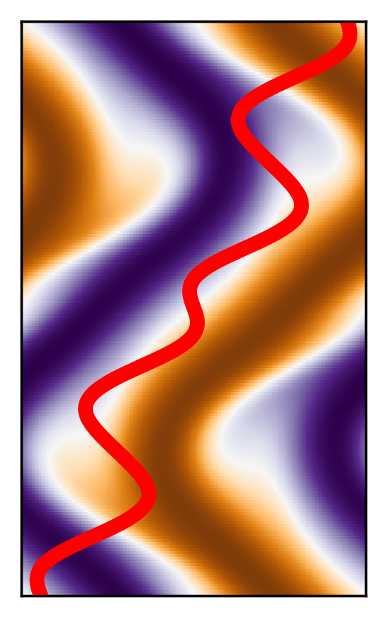
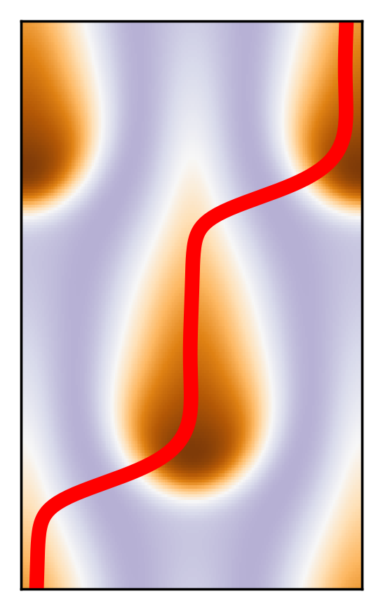
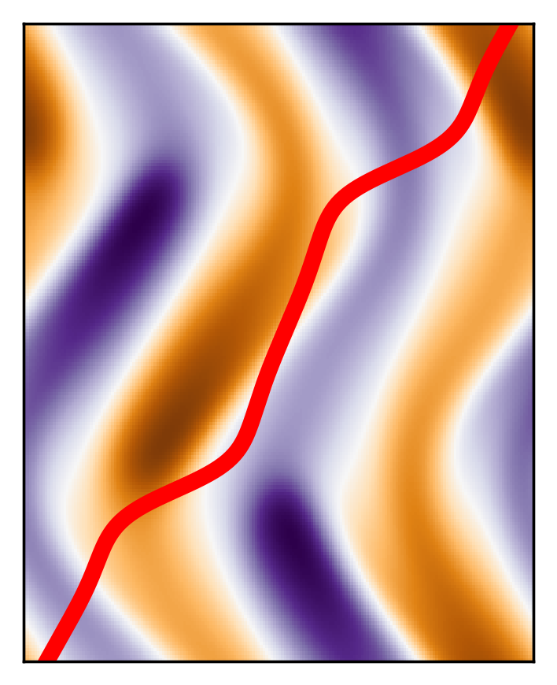
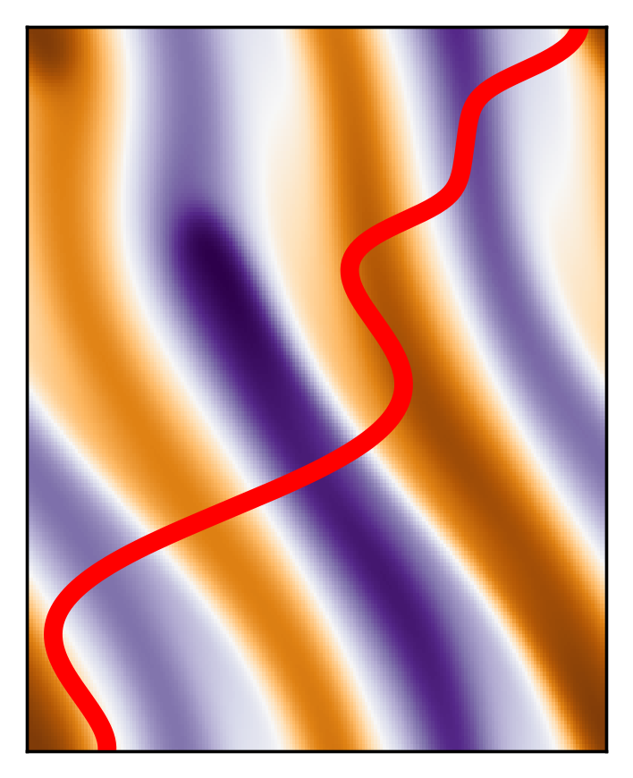

# DECS (Dedalus-ECS)

A **Dedalus**-based solver finding **E**xact **C**oherent **S**tructures in Fluid Dynamics.

In DECS, we separately developed Python classes, including physical models `physics/` in fluid dynamics using [Dedalus](https://dedalus-project.org/), a solver finding ECS `ecs_core/` (equilibria, traveling wave, (relative) periodic orbits), and a continuation feature `continuation/`. 

This code was used for the paper: 
- Van Duc Nguyen, Chang Liu (2026) "Exact Coherent Structures of Salt-Finger Convection: Layering and Shear Formation." (In preparation for submission to Physical Review Letters).

For example, some solutions identified in salt-finger convection include:

<table border="0" >
    <tr>
        <td align="center"><b>Equilibrium</b></td>
        <td align="center"><b>Traveling wave</b></td>
        <td align="center"><b>Periodic orbit</b></td>
        <td align="center"><b>Relative periodic orbit</b></td>
    </tr>
    <tr>
        <td></td>
        <td></td>
        <td></td>
        <td></td>
    </tr>
    <tr>
        <td align="center">(static)</td>
        <td align="center"><a href="examples/Lx0.6_TM1/S1.mp4">Watch video</a></td>
        <td align="center"><a href="examples/Lx0.8_PO3/S2.mp4">Watch video</a></td>
        <td align="center"><a href="examples/Lx0.8_RPO2/S3.mp4">Watch video</a></td>
  </tr>
</table>

Please read examples for conducting [simulation](examples/simulate.py) of [salt-finger convection](docs/models.md), finding [equilibrium](examples/find_eq.py), [traveling wave](examples/find_tw.py), [periodic orbit](examples/find_po.py) and [relative periodic orbit](examples/find_rpo.py); and doing [parameter continuation](examples/continuation.py) of ECS. Also, you can build [new problems](docs/new_problem.md) by yourself if needed.

<!-- Please cite as :  -->

Contact: PhD candidate Van Duc (Duc) Nguyen, School of Mechanical, Aerospace, and Manufacturing Engineering, University of Connecticut, CT, USA

Email: duc.nguyen@uconn.edu

This code is built upon [Dedalus V3.0](https://dedalus-project.org/).