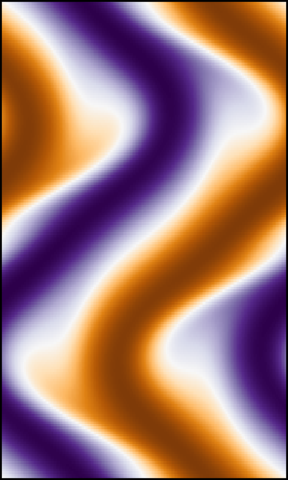
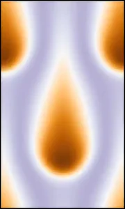
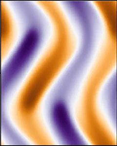
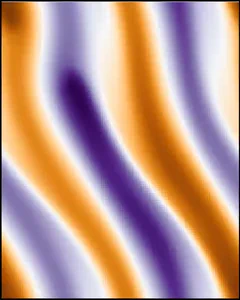

# DECS (Dedalus-ECS)

A **Dedalus**-based solver finding **E**xact **C**oherent **S**tructures in Fluid Dynamics.

DECS couples physical models written with [Dedalus](https://dedalus-project.org/) (`physics/`) to a Newton–Krylov solver (`ecs_core/`) that finds exact coherent structures — equilibria, traveling waves, periodic orbits and relative periodic orbits — computes their linear stability, and continues them in a parameter.

This code was used for the paper:
- Van Duc Nguyen, Chang Liu (2026) "Exact Coherent Structures of Salt-Finger Convection: Layering and Shear Generation." (In preparation for submission to Physical Review Letters).

For example, some solutions identified in salt-finger convection include:

<div align="center">
<table border="0" >
    <tr>
        <td align="center"><b>Equilibrium</b></td>
        <td align="center"><b>Traveling wave</b></td>
        <td align="center"><b>Periodic orbit</b></td>
        <td align="center"><b>Relative periodic orbit</b></td>
    </tr>
    <tr>
        <td align="center"></td>
        <td align="center"></td>
        <td align="center"></td>
        <td align="center"></td>
    </tr>
    <tr>
        <td align="center">(steady)</td>
        <td align="center"><a href="docs/media/TM1_Lx0.6.mp4">full-resolution video</a></td>
        <td align="center"><a href="docs/media/PO3_Lx0.8.mp4">full-resolution video</a></td>
        <td align="center"><a href="docs/media/RPO2_Lx0.8.mp4">full-resolution video</a></td>
  </tr>
</table>
</div>

## Installation

DECS is plain Python on top of [Dedalus v3](https://dedalus-project.org/); there is nothing to build. Install Dedalus (e.g. with conda, following the Dedalus instructions), which brings `numpy`, `scipy`, `h5py`, `mpi4py` and `matplotlib`. For `.nc` output also install `netCDF4`. Then clone this repository and run scripts from it (the examples add the repository root to `sys.path` themselves).

## Package layout

```
physics/                    physical models (Dedalus problems)
  base.py                   FluidModel: state <-> vector, time integration, derivatives
  state_io.py               save_state / load_state (.h5, .nc)
  symmetry.py               Symmetry and reflection / translation operators
  double_diffusion_base.py  DoubleDiffusion: shared base of double-diffusive models
  salt_finger.py            SaltFinger
  thermohaline_shear.py     ThermohalineShear
  double_diffusion.py       other double-diffusive models (not yet validated)
  magneto.py                magnetoconvection models (not yet validated)
ecs_core/                   ECS solver
  newton.py                 ECSSolver: Newton-Krylov hookstep solver
  multishoot.py             MultiShootECSSolver: multiple shooting for PO / RPO
  krylov.py                 GMRES, hookstep and trust region (pure numpy)
  stability.py              Floquet stability analysis
  continuation.py           Continuation: natural / pseudo-arclength continuation
  edge.py                   EdgeTracker: edge tracking by bisection
  poincare.py               PoincareSection, recurrence_search: initial guesses for PO / RPO
  output.py                 logs, CSV and parameter files
examples/                   example scripts and example solutions
tests/                      test suite (pytest), see Tests below
docs/                       documentation
```

## Quick start

Find an equilibrium of salt-finger convection from a stored state:

```python
from physics import SaltFinger, Symmetry
from ecs_core import ECSSolver

model = SaltFinger(params={'Ra': 1e5, 'Pr': 7.0, 'tau': 0.01, 'Rrho': 40.0, 'init_dt': 2e-4},
                   sizes=(128, 128), bounds=(0.6, 1.0))
model.build_problems()
model.load_state('examples/Lx0.6_WF/solution')       # initial guess

solver = ECSSolver(model, {'tol': 1e-9, 'trust_radius': 20.0, 'odir': 'eq_output/'})
solver.sigma.load_from_file('examples/symmetry_pixz.sym')   # optional imposed symmetry
xi, success, residual, norm, properties = solver.solve(x0=model.get_state(), Tp=0.2)
```

Run in parallel with MPI, e.g. `mpiexec -n 4 python3 find_eq.py`.

| Solution type | `solve` arguments | Example |
|---|---|---|
| Equilibrium | `Tp` (fixed integration time) | [find_eq.py](examples/find_eq.py) |
| Traveling wave | `Rxsearch=True` and/or `Rzsearch=True`, initial shift `ax` / `az` | [find_tw.py](examples/find_tw.py) |
| Periodic orbit | `Tsearch=True`, initial period `Tp` | [find_po.py](examples/find_po.py) |
| Relative periodic orbit | `Tsearch=True` and a shift search, e.g. `Rxsearch=True` | [find_rpo.py](examples/find_rpo.py) |
| PO / RPO by multiple shooting | `MultiShootECSSolver(model, {..., 'n_segments': m})`, same `solve` arguments, see [docs](docs/ecs_solver.md#multiple-shooting) | [find_po_multishoot.py](examples/find_po_multishoot.py) |
| Parameter continuation | `Continuation(solver, params).run_continuation(...)`; resume a stopped run with `restart_continuation(...)` | [continuation.py](examples/continuation.py) |
| Poincaré section, recurrence search | `PoincareSection(model, observable, level).run(x0, T)`, `recurrence_search(...)`, see [docs](docs/ecs_solver.md#poincaré-sections-and-recurrence-search) | [poincare_recurrence.py](examples/poincare_recurrence.py) |
| Edge tracking | `EdgeTracker(model, params).track(x_lam, x_turb, T_track)`, see [docs](docs/ecs_solver.md#edge-tracking) | [edge_tracking.py](examples/edge_tracking.py) |
| Direct simulation | Dedalus IVP solver of a model | [simulate.py](examples/simulate.py) |

### Practical notes

- **Output format: NetCDF (`.nc`) by default.** States (`solution`, `unstable_mode_<i>`, continuation states) are saved as `.nc` (`params['ext']`, default `'.nc'`), which opens directly in ParaView and is quick to post-process with `netCDF4` / `xarray`. This needs the `netCDF4` package. Use `'ext': '.h5'` only if you need HDF5.
- **Stability: use Arnoldi for production, the EVP for testing at low resolution.** `stability_method='evp'` builds a nearly dense matrix of about $16 n^2$ bytes ($n \approx 5 N_x N_z$ unknowns in 2-D): 0.7 GB at 32², 2.2 GB at 48², about 100 GB at 128². At production resolutions (e.g. 128²) it raises a `MemoryError`; `ECSSolver` detects this beforehand and falls back to Arnoldi. Use the EVP on grids up to about 48² (64² at most) to test and cross-check Arnoldi, e.g. on a 128² solution interpolated to 48² and reconverged there. See [docs/ecs_solver.md](docs/ecs_solver.md#eigenvalue-problem-evp).

## Models

| Model | Status | Description |
|---|---|---|
| `SaltFinger` | validated | salt-finger convection, fully periodic |
| `ThermohalineShear` | validated | thermohaline-shear instability (Radko 2019) |
| `BoundedSaltFinger`, `DiffusiveConvection`, `ShearedDiffusiveConvection`, `WallShearedDiffusiveConvection` | not validated | other double-diffusive problems |
| `BoundedQuasiStaticMagnetoConvection`, `BoundedQuasiStaticMagnetoConvection_SingleMode` | not validated | quasi-static magnetoconvection |

All models are imported from the package, e.g. `from physics import SaltFinger`.

## Tests

Run the test suite after every code change (a few minutes, needs `pytest`):

```bash
python -m pytest tests
```

- `test_krylov.py`: GMRES, hookstep and trust region on small matrices.
- `test_integration.py`: time integration (solver reuse, step callback, parameter changes, observables).
- `test_poincare.py`: Poincaré crossings and recurrences of a toy limit cycle.
- `test_multishoot.py`: multiple shooting (one segment equals single shooting exactly; Jacobian against finite differences).
- `test_edge.py`: edge tracking on a bistable toy model with a known edge state.
- `test_regression.py`: two Newton iterations of every solution type (EQ, TW, PO, RPO), with fixed time steps and with CFL, plus Arnoldi stability, on a 32² grid. The results must equal `tests/data/regression_reference.npz` exactly.

If a change is *meant* to alter the numerical results, check the new results, then regenerate the reference with `python tests/make_reference.py` and commit it with the change. On another machine or Dedalus/FFTW build, rounding can differ slightly: run with `DECS_EXACT=0` to accept relative differences below 1e-6.

## Documentation

- [Physical models](docs/models.md): governing equations and parameters
- [ECS solver](docs/ecs_solver.md): Newton solver options, symmetries, stability (Arnoldi or eigenvalue problem), continuation and output files
- [Finding periodic orbits from turbulence](docs/finding_po_rpo.md): Poincaré section, recurrence search, choosing the number of segments and the initial guess for PO / RPO
- [New problems](docs/new_problem.md): adding your own model

<!-- Please cite as :  -->

Contact: PhD candidate Van Duc (Duc) Nguyen, School of Mechanical, Aerospace, and Manufacturing Engineering, University of Connecticut, CT, USA

Email: duc.nguyen@uconn.edu

This code is built upon [Dedalus V3.0](https://dedalus-project.org/).
