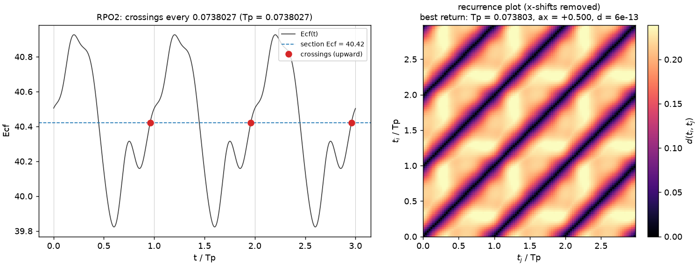
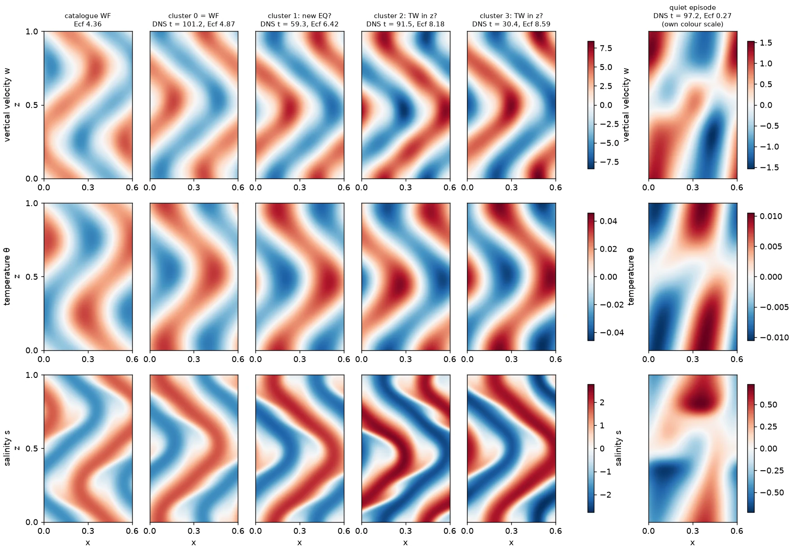
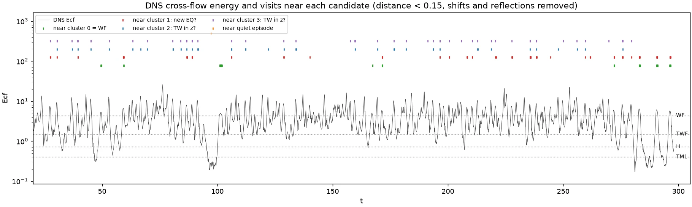
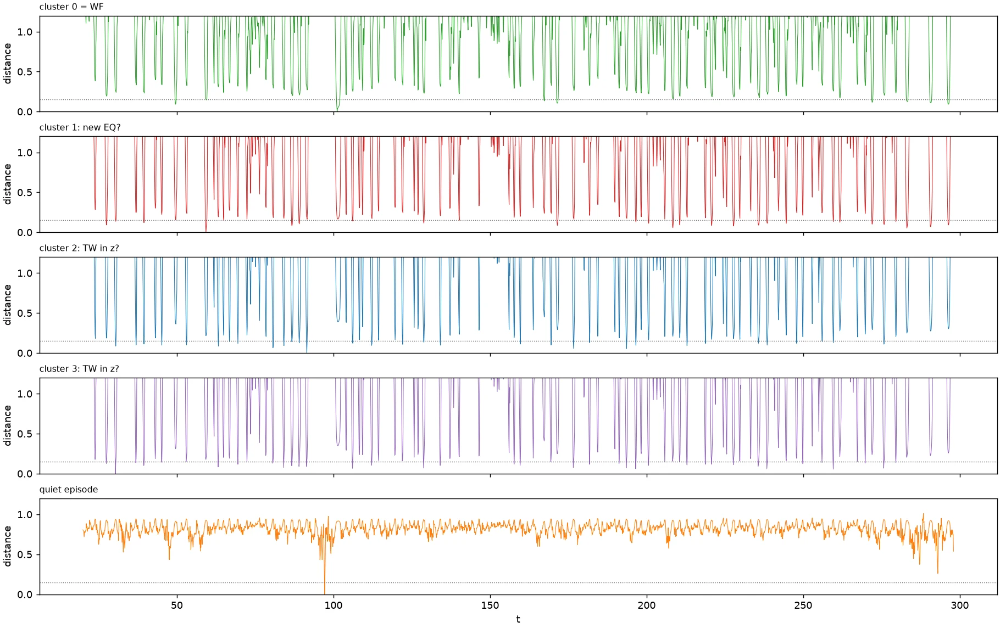
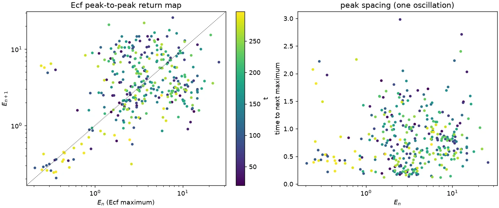

# Finding periodic orbits from turbulence

This guide goes from a turbulent simulation to converged periodic orbits (PO) and relative periodic orbits (RPO): run the flow through a Poincaré section, find near-recurrences, build the best initial guess, and converge it with Newton, by single or multiple shooting. The API of each tool is in [ECS solver](ecs_solver.md); this page is about how to use them together and which choices matter.

```
turbulent run ──► Poincaré section ──► recurrence search ──► guess (Tp, shift, segments) ──► Newton ──► check
 (attractor)       crossings x_n        best (i, j, Tp, a)     single / multiple shooting
```

**Status.** Steps 1–5 and 7–8 work with the current code (single and multiple shooting from one crossing state). The improved multi-snapshot guesses of step 6 (spreading the closing defect, averaging several passes) need `solve` to accept user-supplied segments, which it does not yet: their recipes are given so you know what they do, marked *not yet supported*. Multiple shooting has been verified on converged orbits (PO3, RPO2) but not yet from a rough guess.

**Examples** (run from `examples/`):

| Script | Covers | Run time (one core, 128²) |
|---|---|---|
| [poincare_recurrence.py](../examples/poincare_recurrence.py) | steps 2–4 and 7 on RPO2: section, recurrence search, Newton from the best recurrence | ~20 min |
| [find_po_multishoot.py](../examples/find_po_multishoot.py) | step 7 with multiple shooting (PO3, 3 segments) and Floquet stability | ~25 min |
| [plot_poincare_figure.py](../examples/plot_poincare_figure.py) | the RPO2 figure in step 4 | a few min |

A worked example on a real turbulent run is at the [end of this page](#worked-example-lx--06-salt-finger-dns).

---

## Why this works

Turbulence wanders among unstable solutions and passes close to unstable periodic orbits again and again. A near-recurrence, a state that comes back close to itself (up to a shift) after a time $T$, marks such a pass: the orbit nearby has period about $T$. A Poincaré section reduces the continuous trajectory to the discrete crossings $x_1, x_2, \dots$, so near-recurrences are searched among a few hundred states instead of every time step, and all compared states sit at the same phase of the oscillation.

---

## Step 0. Set up the model

```python
import numpy as np
from physics import SaltFinger
from ecs_core import ECSSolver, MultiShootECSSolver
from tools import PoincareSection, recurrence_search, shifted_distance

params = {'Ra': 1e5, 'Pr': 7.0, 'tau': 0.01, 'Rrho': 40.0, 'init_dt': 1e-4, 'ext': '.nc'}
model = SaltFinger(params=params, sizes=(128, 128), bounds=(0.8, 1.0))
model.build_problems()
```

- **Resolution.** Use the resolution you will converge at. Recurrences found at a coarser resolution are fine as rough guesses, but then interpolate and reconverge.
- **Time stepping.** CFL time stepping (`model.use_CFL = True`) is fastest for the long turbulent run. The model docstring warns that CFL can lose stability in long runs with the default `mode='ecs'` (complex Fourier bases); if that happens, run the turbulence with `mode='sim'` and transfer states to an `'ecs'` model with `save_state` / `load_state` (same grid). For Newton on PO / RPO the examples use fixed time steps (`use_CFL = False`).

---

## Step 1. Get onto the turbulent attractor

Start from a perturbation (or an earlier turbulent state) and discard the transient:

```python
model.set_initial_conditions(mode='random', scale=1e-2)
x = model.get_state()
x = model.flow_map(x, T_transient)        # e.g. a few hundred eddy turnover times
model.save_state('turb/start', x)
```

Watch an observable (Ecf, Nu) during the transient and continue until its statistics stop drifting.

---

## Step 2. Choose the section

The section is $g(x) = c$, crossed in one direction. The default observable is the cross-flow energy $E_{cf} = \tfrac12\langle w^2\rangle$, the volume average of the squared vertical velocity (`model.cross_flow_energy()`). Measure $g$ along the trajectory first:

```python
ecf = lambda m: m.cross_flow_energy()
E = []
model.flow_map(x, T_probe, callback=lambda s: (s.iteration % 10 == 0 and E.append(ecf(model))) and False)
E = np.array(E)
level = E.mean()
```

| Choice | Recommendation | Why |
|---|---|---|
| Observable $g$ | `cross_flow_energy()` (default), or another volume average | invariant under shifts, so drifting RPOs cross at a well-defined phase |
| `level` | near the mean of $g$ | crossed often and transversally; near the minimum or maximum crossings are grazing and badly conditioned |
| `direction` | `+1` | one crossing per oscillation; `0` doubles the number |
| `check_every` | `1` | crossings between checks can be missed |

Any scalar of the current state can be used, as long as it is evaluated on field copies (it runs between time steps; see [ECS solver](ecs_solver.md#poincaré-sections-and-recurrence-search)). A hyperplane through a known state, `lambda m: np.dot(m.current_state() - x_ref, n)`, gives a classical linear section.

---

## Step 3. Run the section

Long runs are best done in chunks: each chunk saves its crossings, and the next chunk starts from where the last one ended.

```python
section = PoincareSection(model, ecf, level=level, direction=+1)
times, states = [], []
t0 = 0.0
for chunk in range(n_chunks):
    crossings = section.run(x, T_chunk, odir=f'turb/section_{chunk}/')
    times += [t0 + c['t'] for c in crossings]
    states += [c['x'] for c in crossings]
    x = section.final_state               # end of the chunk (not model.get_state(): refinement moves it)
    t0 += T_chunk
```

- `run` returns the crossings refined to $|g - c| \le 10^{-10}$ (relative). It keeps every crossing state in memory: about 0.5 MB each for SaltFinger at 128², so a few hundred crossings per chunk are fine.
- With `odir` each chunk writes `crossings.csv` and the states `crossing_<i>`, so the search of step 4 can be redone later without rerunning (see below).
- How long to run: long enough to see each orbit you care about several times. A useful estimate is a few hundred crossings.
- Times are measured from the start of each `run` call: add the chunk's start time `t0`, as in the loop above.

### Output files

`odir/crossings.csv` has one row per crossing:

| Column | Meaning |
|---|---|
| `i` | index of the crossing; its state is saved as `odir/crossing_<i>` (`.nc` or `.h5`, the model's `ext`) |
| `t` | time of the crossing, from the start of this `run` call |
| `g` | the observable at the crossing; it equals `level` to the refinement tolerance |

For example, the run of [poincare_recurrence.py](../examples/poincare_recurrence.py) on RPO2 writes:

```
i, t, g
0, 7.109716762594008e-02, 4.043179933469560e+01
1, 1.448998198076817e-01, 4.043179933518091e+01
2, 2.187024737543101e-01, 4.043179933487810e+01
```

- `g` is the section level, the mean Ecf $= 40.4317993\ldots$ of the probe run, in every row to $5 \times 10^{-10}$ ($10^{-11}$ relative): the refinement places each crossing on the section instead of at the nearest time step.
- The intervals $0.1448998 - 0.0710972 = 0.0738027$ and $0.2187025 - 0.1448998 = 0.0738027$ are the period of RPO2 ($T_p = 0.0738026534$) to $10^{-9}$: one upward crossing per period.
- The first crossing is at $t = 0.071$, not 0: the run starts from the stored state, which is not on the section, and Ecf first rises through the level at about $0.96\,T_p$.

On a turbulent run the file has hundreds of rows with irregular intervals; the near-recurrences among the saved states are what step 4 finds. To redo that search later, load the states back:

```python
import numpy as np
chunk = 0
t0 = chunk*T_chunk                          # start time of this chunk
rows = np.loadtxt(f'turb/section_{chunk}/crossings.csv', delimiter=',', skiprows=1, ndmin=2)
states = []
for i in rows[:, 0].astype(int):
    model.load_state(f'turb/section_{chunk}/crossing_{i}')
    states.append(model.get_state())
times = t0 + rows[:, 1]
```

---

## Step 4. Search for near-recurrences

```python
best = recurrence_search(model, states, times, shift_axes=('x',), T_min=0.0, T_max=T_max, n_best=20)
for r in best:
    print(r)          # {'i', 'j', 'Tp', 'distance', 'ax'}
```

| Target | `shift_axes` | Notes |
|---|---|---|
| PO | `()` | no shift |
| RPO drifting in x | `('x',)` | returns `ax` |
| RPO drifting in z (periodic z) | `('z',)` | returns `az` |
| drift in both | `('x', 'z')` | returns both |

The distance is $d_{ij} = \min_a \lVert S(a)x_j - x_i\rVert / \lVert x_i\rVert$ with $S(a)f(x) = f(x + aL)$, the shift convention of `ECSSolver`: `Tp` and `ax`, `az` are its starting values directly. Reading the results:

- **`T_max` is essential.** Every multiple of a period is a recurrence too. Set it to about 1.5 times the longest period of interest; search several windows (`T_min`, `T_max`) for orbits of different lengths.
- **What distance is good enough.** Rules of thumb, not guarantees: $d \lesssim 0.05$ is an excellent guess, $0.05$–$0.2$ is worth trying (multiple shooting helps most here), $d \gtrsim 0.3$ rarely converges. Converged orbits give $d \sim 10^{-8}$.
- **The same orbit appears many times.** Pairs with nearly equal `Tp` and small mutual distance $d(x_i, x_{i'})$ are passes near one orbit. Keep the smallest distance of each group; the other passes are useful for averaging (step 6c).
- **Symmetric orbits.** An orbit symmetric over half a period crosses the section twice per period (PO3 does). The search still finds the full period, because the two half-period states differ by the symmetry. To find the half-period relation itself, compare with the symmetry applied:

  ```python
  from physics import Symmetry
  sigma = Symmetry(sx=-1, sz=-1)                        # the suspected symmetry
  d, a = shifted_distance(model, states[i], model.apply_symmetry(states[j], sigma), ('x',))
  ```

  If a symmetry is confirmed, impose it in Newton (`solver.sigma`, step 7): it removes neutral directions and usually speeds up convergence.

### Example: RPO2



On the converged relative periodic orbit RPO2 (Lx = 0.8, [poincare_recurrence.py](../examples/poincare_recurrence.py)), the section at the mean of Ecf is crossed upwards once per period (left; crossings 0.0738027 apart). The recurrence plot (right) shows the distance between every pair of states along the orbit with the x-shift removed: besides the trivial main diagonal, the dark diagonals at $t_j - t_i = T_p, 2T_p$ are the returns, and on a turbulent run they would be the short dark streaks to look for. The recurrence search on the crossings returns $T_p = 0.073803$ and $a_x = +0.5000$ at distance $10^{-8}$–$10^{-12}$ (round-off, as the orbit is converged); Newton from that crossing converges to $T_p = 0.0738026534$ in two iterations (residual $1.2 \times 10^{-5} \to 3.4 \times 10^{-9} \to 1.7 \times 10^{-10}$).

---

## Step 5. Choose the number of segments

A correction to the initial state is amplified by about $e^{\lambda T_p}$ over one period, where $\lambda$ is the largest Lyapunov or Floquet exponent. Single shooting works well while $\lambda T_p \lesssim 2$–$3$. Otherwise split the period into $m$ segments with

$$m \approx \lceil \lambda T_p / 1.5 \rceil,$$

so each segment amplifies perturbations by a factor of a few at most. Estimate $\lambda$ from two nearby turbulent trajectories:

```python
xa = states[i]
v = np.random.default_rng(0).standard_normal(xa.size)
xb = xa + 1e-6*np.linalg.norm(xa)/np.linalg.norm(v)*v
d0, t, dt = np.linalg.norm(xb - xa), 0.0, Tp/20
while np.linalg.norm(xb - xa) < 1e-3*np.linalg.norm(xa):
    xa, xb, t = model.flow_map(xa, dt), model.flow_map(xb, dt), t + dt
lam = np.log(np.linalg.norm(xb - xa)/d0)/t
m = max(1, int(np.ceil(lam*Tp/1.5)))
```

More segments cost no extra integration per Jacobian-vector product (the segments cover one period in total), but the unknowns and the Krylov basis grow $m$-fold: `krylov_dim` vectors of $m N$ numbers, about 0.4 GB for $m = 4$ and `krylov_dim = 50` at 128².

---

## Step 6. Build the initial guess

### 6a. Segments from the crossing state (supported)

Pass the crossing state $x_i$, `Tp` and the shift; the solver integrates it to build the segments,

$$x_{k+1} = F^{\tau}(x_k),\qquad \tau = T_p/m,\qquad k = 1, \dots, m-1.$$

These follow the turbulent run itself from $t_i$ to $t_i + (m-1)\tau$ (up to time-stepping differences, as the crossing state is refined). The inner joins start at zero and the whole mismatch, about the recurrence distance, is in the closing join $x_1 - \sigma S(a)F^{\tau}(x_m)$. Even with the same guess as single shooting, multiple shooting gives Newton a better-conditioned problem: the segments can move independently and corrections are amplified over $\tau$, not $T_p$.

### 6b. Spread the closing defect (*not yet supported*)

With a rough recurrence the closing join carries all the error, $D = x_1 - S(a)\,x(t_j)$. Distributing it over the segments starts every join with an error of about $|D|/m$ instead of $|D|$:

$$x_k \leftarrow x(t_i + (k-1)\tau) + \frac{k-1}{m}\, S\!\left(-\tfrac{k-1}{m}a\right) D,\qquad k = 1, \dots, m.$$

The shift $S(-(k-1)a/m)$ moves the correction into the frame of segment $k$, which has drifted by that fraction of $a$. This is a heuristic: it bends the trajectory towards closing but does not follow the flow exactly.

### 6c. Average several passes (*not yet supported*)

When the search finds several passes near the same orbit (step 4), align them at the section, remove the drift with `shifted_distance`, and average the snapshots at each phase $t_i + k\tau$. The random deviations of the individual passes partly cancel, so the average is closer to the orbit than any single pass.

### 6d. Other sources of segments

- Converged segments of a neighbouring parameter value (continuation), a coarser grid (interpolated), or a related orbit (period doubling: perturb along the critical Floquet vector and use $2m$ segments over two periods).
- `Continuation` currently re-splits each predicted point by integrating $x_1$.

---

## Step 7. Converge with Newton

```python
model.use_CFL = False
r = best[0]
solver = MultiShootECSSolver(model, {'n_segments': m, 'tol': 1e-9, 'max_iter': 30,
                                     'trust_radius': 20.0*np.sqrt(m), 'krylov_dim': 50,
                                     'krylov_dim_min': 5, 'computeStability': True,
                                     'odir': f"rpo_T{r['Tp']:.4f}/"})
# solver.sigma = sigma                    # if a symmetry was confirmed in step 4
xi, success, residual, norm, props = solver.solve(x0=states[r['i']], Tsearch=True,
                                                  Rxsearch=True, Tp=r['Tp'], ax=r['ax'])
```

For a PO drop `Rxsearch` and `ax`; with `m = 1` (or `ECSSolver`) this is single shooting.

| Option | Recommendation |
|---|---|
| `n_segments` | from step 5; 1 for short, mildly unstable orbits |
| `trust_radius` | the trust region bounds the whole step over all $m$ segments: scale the single-shooting value by about $\sqrt{m}$ |
| `tol` | `1e-9` as in the examples; the residual adds the mismatches of all segments |
| `krylov_dim` | 50; raise it if the GMRES error stays large |
| `max_iter` | 20–30; hookstep iterations from rough guesses are slow at first, then fast |

Signs of trouble: the trust radius shrinks to `trust_radius_min` without progress (guess too far: try the next recurrence, more segments, or 6b once available), `Tp` drifts to a multiple or a fraction of the guess (another orbit, or the half-period symmetry), or the residual stalls around $10^{-4}$–$10^{-6}$ (resolution or time step too coarse: check the spectra, reduce `init_dt`).

---

## Step 8. Check and catalogue

- **Converged?** `success` and `residual < tol`; `output.log` in `odir` lists every iteration.
- **Single-shooting check.** Rerun the converged $x_1$ with `ECSSolver`: the initial residual should be at the same level.
- **Stability.** With `computeStability` the Floquet multipliers are computed on the full period. Count the unstable ones; one unstable direction marks an edge-state candidate.
- **New or known?** Compare with the solutions you already have, with the shift removed: `shifted_distance(model, x_new, x_known, ('x',))[0] < 1e-6` means the same orbit. Different crossing states of one orbit match only after integrating to the same phase.
- **Time history.** On convergence the solver saves the solution, the snapshots and flow properties of the orbit (`save_snapshots`, `save_flowproperties`) for videos and averages.

---

## Cost overview

| Step | Cost |
|---|---|
| Turbulent run with section | the run itself, plus one observable and one state copy per time step, plus a few steps per crossing to refine it |
| Recurrence search | $n^2/2$ comparisons of $n$ crossings, one FFT each with shifts: seconds to minutes for a few hundred crossings |
| Newton | per iteration about `krylov_dim` integrations over one period (any $m$), plus the trust-region trials |

At 128², one period of PO3 ($T_p = 0.215$, $\Delta t = 3 \times 10^{-4}$) takes about 30 s on one core, so a Newton iteration with 20–50 Krylov vectors takes 10–25 minutes; run Newton with MPI on a cluster.

---

## Worked example: Lx = 0.6 salt-finger DNS

A chaotic DNS of `SaltFinger` (Ra = 1e5, Pr = 7, τ = 0.01, Rρ = 40, Lx = 0.6, 128²) with snapshots written every 0.1 for t = 0–335. It shows what such a search finds in practice, including what goes wrong. Newton has not yet been run on any of the candidates below, so none is a confirmed solution.

**Check the run first.** Ecf grows by a factor 1.3 per snapshot from t ≈ 300.5 and is NaN from t = 303.5: a numerical blow-up. The analysis uses t = 20–298.

The distances, recurrences, slow points and visits below come from the snapshot-series tools `lag_distances`, `recurrences`, `slow_points`, `reference_distances` and `nearest_solution` (see [Snapshot series](ecs_solver.md#snapshot-series-recurrences-slow-points-and-visits)).

**Snapshots alone are too coarse for periodic orbits.** Consecutive snapshots differ by 25–90 % in norm, so a stored-snapshot recurrence cannot get much closer than that, and the long leave-and-return recurrences that the search does find (Tp = 2–5) all start and end in the same region with random shifts: excursions, not orbits. Periodic orbits need the section to be run at every time step (step 3) on re-runs of chosen windows.

**Slow points give equilibrium and traveling-wave candidates.** The shift-removed change per snapshot, $\min_a \lVert S(a)x(t+\Delta t) - x(t)\rVert/\lVert x(t)\rVert$, is small where the flow lingers near an equilibrium or traveling wave (the drift over $\Delta t$ gives its speed). The slowest snapshots, grouped when they are within 0.15 of each other up to shifts and reflections, form a few clusters; comparing them with the known solutions at Lx = 0.6 separates known from new:



Cluster 0 is the known equilibrium WF (0.065 away), which validates the method. Clusters 1–3 have the chevron shape of WF but higher Ecf and sharper salinity fronts, 0.19–0.33 from every known solution: candidates for a WF-family branch, an equilibrium (cluster 1) and traveling waves in z (clusters 2, 3, with drifts $c_z \approx \pm 0.06$–$0.09$). The quiet episode (right, own colour scale) is a weak state of different shape.





The distance to clusters 0–3 dips at the same times, once per burst of Ecf: they are one region of state space that the flow crosses repeatedly, and which cluster a pass falls into depends on how close it gets. The quiet episodes (t ≈ 92–100, 283–296, Ecf ≈ 0.2–0.4) are each followed by a visit near WF.

**Rank the candidates before running Newton.** The relative residual $\lVert x - G(x)\rVert/\lVert x\rVert$ of a candidate over $T_p = 0.2$ costs seconds and compares directly with a known solution: the pass 0.065 from WF gives 0.054, cluster 1 (t = 283.1) gives 0.071, the best traveling-wave candidate 0.181, and the quiet episodes 0.45–0.86, too far from an equilibrium or traveling wave.

**The Ecf peak-to-peak map points to periodic orbits.** Successive maxima of Ecf (reliable at the 0.1 sampling, since Ecf varies slowly) plotted against each other:



The bursts (Ecf ≈ 1–20) form a structureless cloud. The quiet episodes (Ecf < 1) lie along the diagonal with peak spacing 0.2–0.6 and slowly growing peaks, as a trajectory spiralling away from a weakly unstable oscillation does: the windows to re-run with a section at every step, as candidates for a weak periodic orbit.

**Next steps for this run:** Newton on cluster 1 (equilibrium, from t = 283.1) and on the traveling-wave candidates, with the pass near WF as a control; a fine Poincaré section (steps 2–4) on re-runs of the quiet episodes, then multiple shooting (steps 5–7) on the best recurrences.
